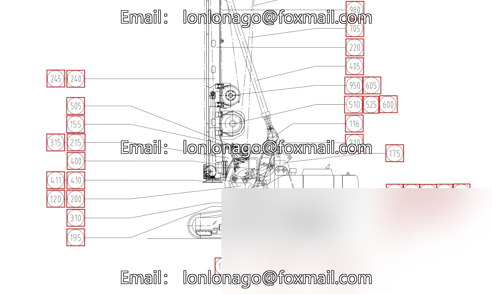
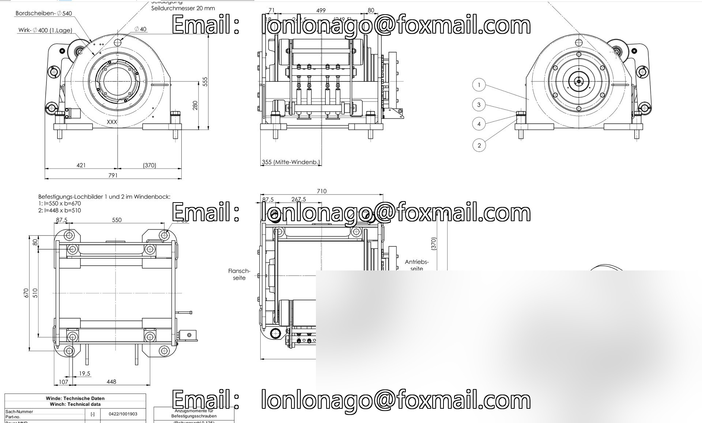
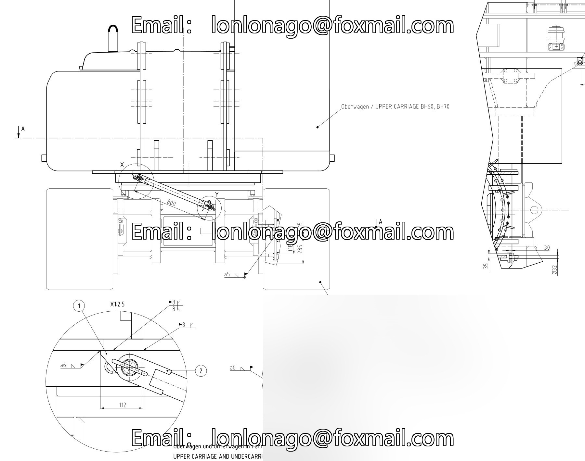

# BAUER BG 25 BH 70 drill rig (serial number 2254) front suspension

## Body

BAUER BG 25 BH 70 drilling rig (serial number 2254), front suspension structure engineering drawing, scale 1:50, with a total of 250 pages, electronic data materials.

The drilled mast front suspension engineering drawing is in ratio 1:50 and consists of 250 pages, showing dimensions, structural information and related technical data.

<!-- AI_ENRICHED -->

## Images

## Payment

Here is a pay link on Stripe ( https://buy.stripe.com/3cs8yP7sY87d0vu9AB ). Please contact me lonlonago@foxmail.com after funding $89, and I will send you a complete data files , thank you!

